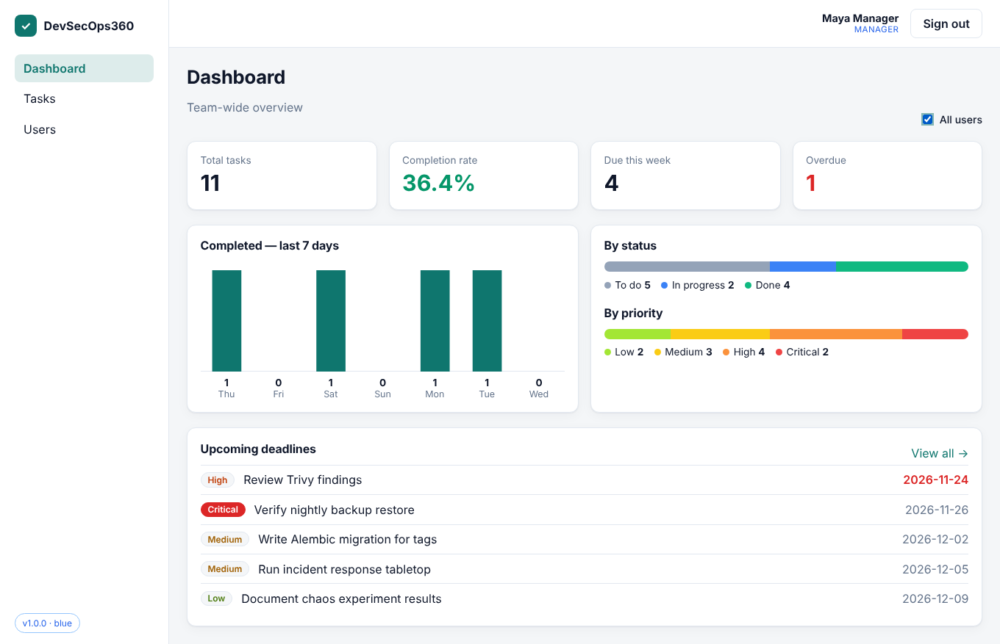
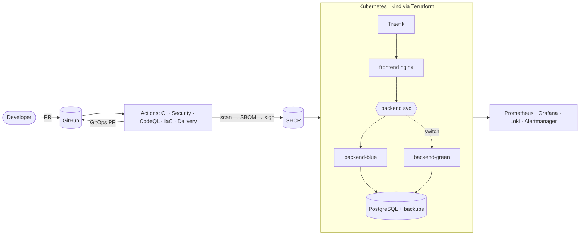

# DevSecOps360

**Secure, Automated, Observable & Self-Healing Software Delivery Platform**

[](../../actions/workflows/ci.yml)
[](../../actions/workflows/security.yml)
[](../../actions/workflows/delivery.yml)
[](../../actions/workflows/iac.yml)

A full-stack task-management app (React + FastAPI + PostgreSQL) delivered through a
production-style platform: CI/CD with security gates, signed images with SBOMs, Kubernetes with
**blue-green deployments and automatic rollback**, Terraform and Ansible, Prometheus, Grafana and
Loki with SLOs and burn-rate alerts, load testing, verified backups and chaos experiments. It is
built to run on an **8 GB Windows laptop** using only free and open-source tools.



## Highlights (measured, not claimed)
| | |
|---|---|
| Tests | **60** backend (unit + integration on PostgreSQL 16 + deployment logic) · **20** frontend · **4** Playwright E2E |
| Coverage | **97.9 %** backend · **79.3 %** frontend |
| Security scans run | pip-audit ✔ 0 · npm audit ✔ 0 · Bandit ✔ 0 · custom Semgrep ✔ 0 (each rule proven to fire) |
| Kubernetes | 3 overlays · 36/36 objects pass strict K8s 1.31 schema · 0 policy violations |
| Performance | 25 users: p95 **24 ms**, 0 % errors · 100 users: bottleneck found and fixed, errors 39.6 % → **0.67 %**, 2.7 → **50 req/s** |
| DR | backup 0.18 s / restore 0.17 s, row counts verified |

Details and what still needs to run on your machine: [docs/testing/test-results.md](docs/testing/test-results.md).

## Architecture

More: [architecture](docs/architecture/architecture.md) · [ADRs](docs/adr/README.md) · [threat model](docs/security/threat-model.md)

## Quick start (Windows PowerShell 7)
Prerequisites: Docker Desktop (WSL2 backend), Git, Python 3.12, Node 22. See [installation guide](docs/guides/installation.md).
```powershell
git clone https://github.com/your-github-username/devsecops360.git C:\dev\devsecops360
Set-Location C:\dev\devsecops360
.\scripts\dev.ps1 up          # generates .env with random secrets, builds, starts db+backend+frontend (~600 MB)
```
Open **http://localhost:8080** (API docs: `/docs`). Logins are printed on first run:
`admin@devsecops360.dev` and the demo users `alice@`, `bob@`, `manager@devsecops360.dev`.

| Want | Command |
|---|---|
| + Prometheus, Grafana (:3000), Loki, Alertmanager | `.\scripts\dev.ps1 up-full` |
| Run all tests | `.\scripts\dev.ps1 test` |
| Smoke / E2E against the stack | `.\scripts\dev.ps1 smoke` · `.\scripts\dev.ps1 e2e` |
| Security scans | `.\scripts\dev.ps1 scan` |
| Backup / restore | `.\scripts\backup\backup.ps1` · `.\scripts\backup\restore.ps1 -File latest` |
| Kubernetes (kind + Terraform) | `.\scripts\dev.ps1 cluster` then `.\scripts\dev.ps1 k8s-deploy` → http://devsecops360.localtest.me:8088 |
| Blue-green release / rollback | `.\deployment\scripts\blue-green-deploy.ps1 -Image devsecops360-backend:v1.1.0` · `.\deployment\rollback\rollback.ps1` |
| Stop | `.\scripts\dev.ps1 down` |

Linux/WSL: the same targets exist in the `Makefile` (`make up`, `make test`, `make k8s-deploy`, …).
Full walkthrough with every level: [local setup guide](docs/guides/local-setup.md).

## What's inside
| Area | Implementation |
|---|---|
| **App** | FastAPI · SQLAlchemy 2 · Alembic · JWT (HS256) · bcrypt · RBAC (admin/manager/user) · analytics · OpenAPI · React 19 + TypeScript + Vite · responsive · dependency-free SVG charts |
| **Testing** | pytest (unit, integration on Postgres, deployment logic) · Vitest + Testing Library · Playwright · smoke tests used as deploy gates · Locust with SLO gate |
| **Containers** | Multi-stage, non-root, read-only FS, dropped caps, healthchecks · Compose profiles · internal data network |
| **CI/CD** | `ci.yml` · `security.yml` · `codeql.yml` · `iac.yml` · `delivery.yml` (build → Trivy gate → SBOM → GHCR + provenance → cosign → ephemeral kind deploy → blue-green + rollback drill → GitOps PR) · Dependabot |
| **DevSecOps** | gitleaks · Semgrep (+ custom rules) · CodeQL · Bandit · pip-audit · npm audit · Trivy (fs, IaC, image) · SBOM SPDX/CycloneDX · cosign keyless · STRIDE threat model |
| **Kubernetes** | Kustomize base + blue-green + dev/staging/prod overlays · StatefulSet + PVC · probes · HPA · PDB · RBAC · NetworkPolicies (default deny) · PSA restricted · LimitRange/Quota · migration Job · backup and restore-verify CronJobs · Traefik ingress + middlewares |
| **IaC** | Terraform modules: `kind-cluster`, `platform-addons` (Traefik, metrics-server, monitoring, Argo CD), `app-namespace` (namespace + generated secrets) · environments: local/staging/production |
| **Config mgmt** | Ansible roles: common, docker, k8s_tools, app_deploy (Vault), backup · idempotent · ansible-lint `production` profile |
| **Observability** | Prometheus RED + business metrics · SLO recording rules · multi-window burn-rate alerts · Alertmanager · Grafana dashboard-as-code · Loki + Alloy · JSON logs with request-id |
| **SRE** | SLIs/SLOs/error-budget policy · 9 runbooks · incident response · chaos experiments · backup + automated restore verification · RPO/RTO |

## Repository layout
```
apps/backend/            FastAPI service, Alembic migrations, seed data
apps/frontend/           React + Vite + TypeScript SPA, nginx config
database/                init SQL, schema docs
docker/                  backend & frontend Dockerfiles
tests/                   unit · integration · deployment · smoke · e2e (Playwright)
.github/workflows/       ci · security · codeql · iac · delivery
kubernetes/              base · blue-green · overlays/{development,staging,production}
terraform/               modules/ · environments/{local,staging,production}
ansible/                 playbooks/ · roles/ · inventories/
security/                gitleaks, Trivy, Semgrep rules
observability/           prometheus · alertmanager · grafana · loki · kubernetes (Helm values, PodMonitor, rules)
deployment/              scripts (deploy, blue-green, secrets, smoke) · rollback · gitops (Argo CD)
load-testing/            Locust scenarios with SLO gate
scripts/                 dev.ps1 task runner · backup · chaos · security-scan · validators
docs/                    architecture · adr · security · sre · runbooks · guides · deployment · testing · evidence · report
```

## Git workflow
GitHub Flow: protected `main` (PR + required checks + signed commits), short-lived
`feat/*`, `fix/*`, `chore/*` branches, and [Conventional Commits](https://www.conventionalcommits.org/)
(`feat: add task search`, `fix(auth): release DB connection before bcrypt`). See the
[PR template](.github/pull_request_template.md).

## Documentation
| Guides | Operations | Academic |
|---|---|---|
| [Installation](docs/guides/installation.md) | [SLOs & alerting](docs/sre/slos.md) | [Report](docs/report/academic-report.md) |
| [Local setup](docs/guides/local-setup.md) | [Runbooks](docs/runbooks/README.md) | [120-mark mapping](docs/report/evaluation-mapping.md) |
| [Deployment](docs/deployment/deployment-guide.md) | [Backup & DR](docs/runbooks/backup-and-restore.md) | [Presentation outline](docs/report/presentation-outline.md) |
| [Blue-green](docs/deployment/blue-green.md) | [Incident response](docs/runbooks/incident-response.md) | [Demo scripts](docs/report/demo-scripts.md) |
| [Testing](docs/testing/testing-guide.md) | [Chaos experiments](scripts/chaos/README.md) | [60 viva Q&A](docs/report/viva-questions.md) |
| [Security](docs/security/security-guide.md) | [Performance report](docs/testing/performance-report.md) | [Milestones](docs/project/milestones.md) |
| [Troubleshooting](docs/guides/troubleshooting.md) | [Evidence](docs/evidence/README.md) | [ADRs](docs/adr/README.md) |

## Before you push
Replace `your-github-username` everywhere (`git grep your-github-username`), run
`pre-commit install`, and never commit `.env`, `terraform.tfvars`, `*.tfstate` or `vault.yml`
(they are git-ignored).

## License
[MIT](LICENSE)
