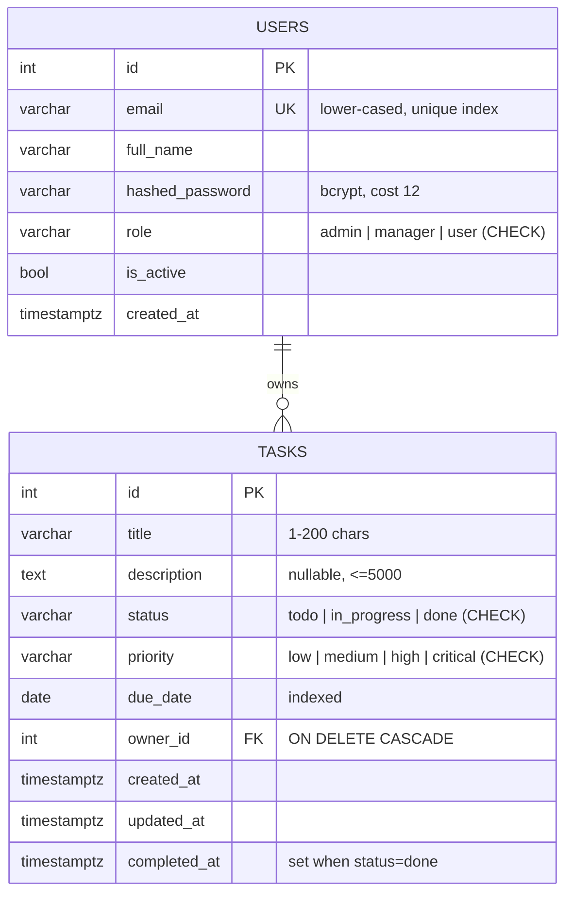

# Schema

Indexes: `users.email` (unique), `tasks.owner_id`, `tasks.status`, `tasks.priority`, `tasks.due_date`.

Enums are stored as `VARCHAR + CHECK` (`native_enum=False`) so adding a value is a
simple, reversible migration instead of an `ALTER TYPE`.
