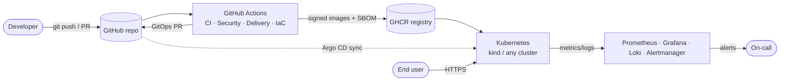
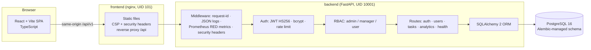
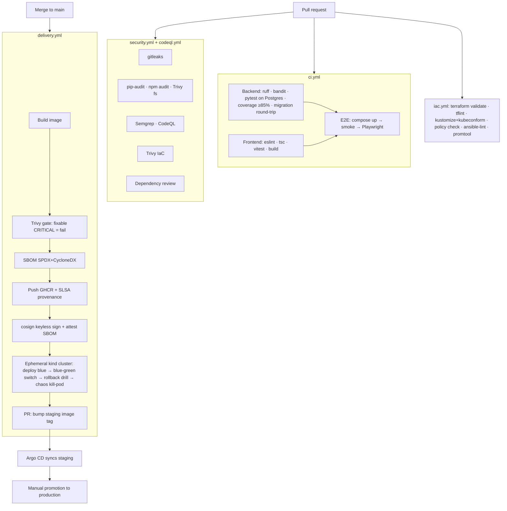
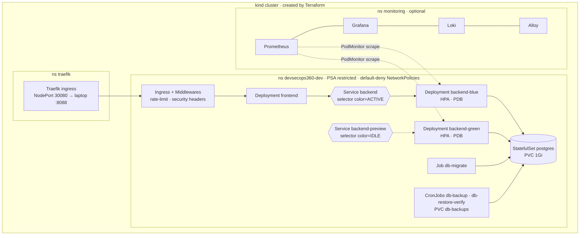

# DevSecOps360 — Architecture

## 1. Context

DevSecOps360 is a task-management application **and** the delivery platform around it.
The application is deliberately small. The engineering effort goes into how it is
built, secured, deployed, observed and recovered.

## 2. Application architecture

| Concern | Implementation |
|---|---|
| AuthN | `POST /auth/login` → JWT (HS256, `exp`/`iat`/`iss`, 60 min). bcrypt cost 12, timing-equalised for unknown users. |
| AuthZ | `require_roles()` dependency; ownership checks on every task query (404 not 403 to prevent ID probing). |
| Validation | Pydantic schemas (lengths, enums, password policy); uniform 422 error shape. |
| Errors | No stack traces to clients; a 500 includes a `request_id` for log correlation; DB overload returns 503 + `Retry-After`. |
| Observability | `/metrics` (RED + business metrics), JSON logs with `request_id`, `/health/live` and `/health/ready`. |
| Blue-green identity | `APP_COLOR` env → `/api/v1/version` and the `app_info` metric. |

### Data flow: create a task
1. The SPA sends `POST /api/v1/tasks` with `Authorization: Bearer <jwt>`.
2. nginx proxies to the `backend` Service and adds `X-Request-ID`.
3. Middleware starts a timer, binds `request_id` to the logging context and increments in-flight requests.
4. `get_current_user` verifies the JWT signature, expiry and issuer, loads the user and rejects inactive accounts.
5. Pydantic validates the body. The ORM inserts the row inside a transaction.
6. The response carries security headers. Metrics `http_requests_total{route="/api/v1/tasks",status="201"}` and the latency histogram are updated. One JSON log line is emitted, and Alloy ships it to Loki.

## 3. Delivery pipeline

## 4. Kubernetes architecture

**Security layers in the namespace:** Pod Security Admission `restricted`. Every pod runs
non-root with a read-only root filesystem, all capabilities dropped and seccomp
`RuntimeDefault`. No ServiceAccount tokens are mounted. Default-deny ingress and egress,
with explicit allow rules. LimitRange and ResourceQuota cap usage. RBAC uses namespaced
`deployer` and `viewer` roles only.

## 5. Environments

| | Development | Staging | Production |
|---|---|---|---|
| Where | kind on the laptop | any cluster (Terraform `staging`) | any cluster (Terraform `production`) |
| Images | `:local`, loaded into kind | GHCR `sha-<commit>`, GitOps PR | GHCR semver tag (policy forbids `:latest`) |
| Replicas (backend) | 1 (HPA ≤2) | 2 (HPA 2–4) | 3 (HPA 3–6) |
| Docs (`/docs`) | on | on | **off** |
| Backups | every 2 h | every 6 h | hourly (RPO ≤ 1 h) |
| Deploy | script / Ansible | Argo CD auto-sync | Argo CD manual sync + blue-green |

## 6. Resource budget (8 GB laptop)

| Mode | Components | Measured on | Approx. RAM |
|---|---|---|---|
| Compose core | db + backend + frontend | Compose `mem_limit` caps | ≤ 576 MB (caps) |
| Compose full | core + Prometheus, Grafana, Loki, Alloy, Alertmanager, pg-exporter | caps | ≤ 1.5 GB (caps) |
| kind dev | node + Traefik + metrics-server + app | estimate | ~1.5–2 GB |
| kind + monitoring | above + kube-prometheus-stack + Loki | estimate | ~3–3.5 GB |

Run **either** Compose **or** kind, not both. Monitoring is opt-in in both.
