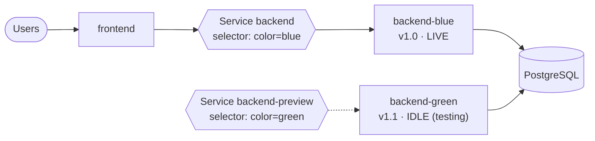

# Blue-Green deployment explained

## The idea in one picture

Two complete copies of the backend exist. Users only ever reach the colour the `backend`
Service selects. A release goes to the **idle** colour, is tested privately through
`backend-preview`, and then the selector flips. Rollback flips it back.

## Step by step (what `blue-green-deploy.sh` does)
| # | Step | Command (simplified) | If it fails |
|---|---|---|---|
| 1 | Detect active/idle | `kubectl get svc backend -o jsonpath='{.spec.selector.devsecops360/color}'` | abort |
| 2 | Migrate DB with the **new** image | Job `db-migrate` (expand-only migrations) | abort; nothing switched |
| 3 | Deploy to idle | `kubectl set image deploy/backend-green …` + `scale` + `rollout status` | abort; users on blue |
| 4 | Pre-switch smoke test | in-cluster pod → `http://backend-preview:8000` (health, color, register, CRUD, auth check) | abort; users on blue |
| 5 | **Switch** | `kubectl patch svc backend -p '{"spec":{"selector":{"devsecops360/color":"green"}}}'` | — |
| 6 | Post-switch verification | smoke pod → `http://frontend:8080` (the real user path) expecting `color=green` | **automatic rollback** to blue |
| 7 | Keep old colour | blue stays running → instant manual rollback | — |

## Why the switch is safe and instant
- A Service selector patch is a single atomic API update. kube-proxy reprograms endpoints in about 1–3 s.
- New connections go to green. Blue pods keep running, so in-flight requests complete (no pod is killed).
- Both colours validate the same JWTs (shared secret) and use the same DB, so users stay logged in.

## The database rule (most important caveat)
Both colours talk to **one** database, so every migration must work with the old *and*
new code (ADR-0010, expand → migrate → contract). Example: renaming `title` to `name`
takes 3 releases: add `name` → write both and read `name` → drop `title`.

## Observing a switch
- UI: the badge (bottom-left) shows `v<version> · <color>` from `/api/v1/version`.
- Grafana: the **Serving instances by colour** panel (`app_info`); request rate per pod.
- Loki: `{service="backend", color="green"}`.
- `./deployment/scripts/status.sh` shows a table of colours, images, readiness and the active marker.

## Blue-green vs rolling vs canary
| | Rolling | **Blue-green** | Canary |
|---|---|---|---|
| Test before users see it | ✗ | ✅ (preview svc) | partial (small % of users) |
| Rollback speed | minutes (new rollout) | **seconds** (selector) | seconds |
| Extra capacity | +1 pod (surge) | 2× during release | small |
| Extra tooling | none | none (vanilla K8s) | Argo Rollouts / mesh |
| Blast radius of a bad release | grows during rollout | 0 before switch; 100 % after (auto-verified) | small % |

**Canary extension (optional):** run both colours behind the `backend` Service with a
replica ratio (e.g. green 1 pod, blue 3 pods ≈ 25 % canary), watch the error-rate panel,
then complete the switch. For precise percentages use Argo Rollouts with Traefik weighted
services. Documented as future work.
