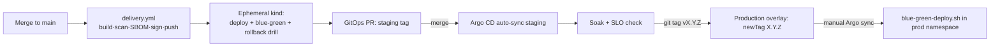

# Deployment guide

## Paths to production



## 1. Container registry (GHCR)
- Images: `ghcr.io/<owner>/devsecops360-backend` and `-frontend`.
- Tags: `sha-<12 hex>` (every main commit), `X.Y.Z` (git tag `vX.Y.Z`), `latest` (main, convenience only; the production policy forbids it).
- Auth in CI: the built-in `GITHUB_TOKEN` (`packages: write`); no personal tokens.
- Pull from a cluster (private repo): `kubectl create secret docker-registry ghcr --docker-server=ghcr.io --docker-username=<user> --docker-password=<PAT with read:packages>` and add `imagePullSecrets` (public repos need nothing).
- Local alternative without a registry: `kind load docker-image`.

## 2. Environments
| Overlay | Namespace | How it gets deployed |
|---|---|---|
| development | devsecops360-dev | `deployment/scripts/deploy-k8s.*` or `ansible-playbook playbooks/deploy-k8s.yml` |
| staging | devsecops360-staging | Argo CD auto-sync of `kubernetes/overlays/staging` (tag bumped by the pipeline PR) |
| production | devsecops360-prod | Argo CD manual sync + `blue-green-deploy` with the released tag |

## 3. First-time setup per environment
1. Infrastructure: `terraform apply` in `terraform/environments/<env>` (namespace, secrets, add-ons, Argo CD).
2. Optional GitOps: edit `repoURL` in `deployment/gitops/argocd-applications.yaml`, then `kubectl apply -f` it.
3. Production TLS: install cert-manager and a ClusterIssuer; the production overlay already references `secretName: devsecops360-tls`.

## 4. Releasing
```bash
git tag -s v1.1.0 -m "v1.1.0"; git push origin v1.1.0      # delivery.yml builds X.Y.Z images
# update production overlay newTag: "1.1.0" via PR → review → merge
NAMESPACE=devsecops360-prod OVERLAY=production \
  ./deployment/scripts/blue-green-deploy.sh ghcr.io/<owner>/devsecops360-backend:1.1.0
```
The frontend is stateless and uses a rolling update (`maxUnavailable: 0`). The backend uses blue-green.

## 5. Rollback
See [runbooks/deployment-rollback.md](../runbooks/deployment-rollback.md). It is one selector patch, verified.

## 6. Configuration reference
| Variable | Where | Notes |
|---|---|---|
| `ENVIRONMENT` | ConfigMap | `production` disables `/docs` and enforces secret strength |
| `DATABASE_URL` | composed from ConfigMap + Secret | `postgresql+psycopg://…` |
| `JWT_SECRET_KEY` | Secret | ≥ 32 chars, enforced outside dev |
| `ACCESS_TOKEN_EXPIRE_MINUTES` | ConfigMap | 60 (30 in production) |
| `CORS_ORIGINS` | ConfigMap | comma-separated allow-list |
| `APP_COLOR` | Deployment env | `blue` / `green`, set by Kustomize |
| `RUN_MIGRATIONS` | ConfigMap | `false` in K8s (the Job migrates), `true` in Compose |
| `SEED_SAMPLE_DATA` | ConfigMap / .env | demo data; `false` outside dev |
| `LOGIN_RATE_LIMIT_PER_MINUTE` | env | default 10 per IP+email |
