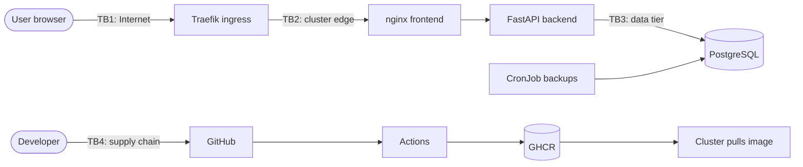

# Threat Model (STRIDE)

**Scope:** DevSecOps360 application, CI/CD pipeline, container images, Kubernetes runtime.
**Method:** data-flow diagram, then STRIDE per element and trust boundary, then mitigations mapped to code.
**Review:** on every architectural change, and at least once per release.

## 1. Assets
| Asset | Why it matters |
|---|---|
| User credentials (password hashes) | Account takeover; password reuse on other sites |
| JWT signing key | Forging tokens = full impersonation, incl. admin |
| Task data | Confidentiality and integrity of user content |
| Database credentials | Direct data access that bypasses all app controls |
| CI/CD pipeline and registry | Compromise = malicious code shipped to production |
| Backups | Contain all data; also our recovery path |

## 2. Data flow & trust boundaries

## 3. STRIDE analysis

| # | Threat (STRIDE) | Element | Scenario | Mitigation (where) | Residual risk |
|---|---|---|---|---|---|
| T1 | **S**poofing | Login | Credential stuffing / brute force | bcrypt cost 12; per IP+email rate limit (`core/ratelimit.py`); ingress rate limit (Traefik middleware); `LoginBruteForceSuspected` alert | Distributed attacks across many IPs → add CAPTCHA/MFA |
| T2 | **S**poofing | JWT | Forged token, `alg=none`, key confusion | HS256 only, `algorithms=[...]` pinned, `iss`/`exp` required (`core/security.py`), tests for tampering and `none` | Key theft → rotate `JWT_SECRET_KEY` (invalidates all tokens) |
| T3 | **S**poofing | Account enumeration | Different errors/timing for unknown emails | Identical 401 body; dummy-hash verification equalises timing (`routes/auth.py`) | Registration reveals "email exists" (409). Accepted for UX |
| T4 | **T**ampering | Tasks | IDOR: edit another user's task by ID | Ownership check on every query; 404 (not 403) for foreign IDs; integration tests | — |
| T5 | **T**ampering | DB | SQL injection | SQLAlchemy bound parameters only; Semgrep rule bans raw f-string SQL; sort column allow-list | — |
| T6 | **T**ampering | Supply chain | Malicious dependency or base image | Lockfiles, pinned versions, pip-audit, npm audit, Trivy, Dependency Review, Dependabot, SBOM | Zero-day in a dependency |
| T7 | **T**ampering | Images | Registry image swapped after build | cosign keyless signature + verification, digest-pinned deploys, SLSA provenance | No admission-time signature enforcement yet (next step: Kyverno `verifyImages`) |
| T8 | **R**epudiation | Admin actions | Admin denies changing roles | Structured audit log lines (`role_changed` with actor, target, request_id) shipped to Loki | Logs are retained 72 h locally; ship to WORM storage in production |
| T9 | **I**nformation disclosure | API errors | Stack traces leak internals | Global handler returns generic 500 + request_id; docs disabled in production | — |
| T10 | **I**nformation disclosure | Secrets | Secrets committed to Git | gitleaks (pre-commit + CI + full history); `.env` git-ignored; generated secrets | Developer machine compromise |
| T11 | **I**nformation disclosure | XSS → token theft | Injected script reads sessionStorage token | React auto-escaping; ESLint/Semgrep ban `dangerouslySetInnerHTML`; strict CSP `script-src 'self'`; short token TTL | httpOnly cookie would remove JS access (ADR-0003 trade-off) |
| T12 | **I**nformation disclosure | Network | Lateral movement from a compromised pod to DB | Default-deny NetworkPolicies; DB accepts only backend + labelled jobs; DB has no egress; Compose `data` network is internal | — |
| T13 | **D**enial of service | API | Request floods, huge payloads | Traefik rate limit; nginx `client_max_body_size 1m`; pagination `size ≤ 100`; field length limits; pool timeout → fast 503 | Volumetric DDoS needs an upstream CDN/WAF |
| T14 | **D**enial of service | Cluster | Runaway pod exhausts the node | Requests and limits on every container; LimitRange; ResourceQuota; HPA; PDB | — |
| T15 | **E**levation of privilege | Registration | User self-assigns admin | Role field ignored on register; only admins change roles; admins cannot demote themselves; tests | — |
| T16 | **E**levation of privilege | Container escape | Exploit gains root on node | Non-root UIDs, read-only root FS, all capabilities dropped, `no-new-privileges`, seccomp RuntimeDefault, PSA `restricted`, no SA tokens mounted | Kernel 0-day |
| T17 | **E**levation of privilege | CI | Malicious PR exfiltrates secrets | `permissions: contents: read` by default; OIDC instead of stored registry tokens; `pull_request` (not `pull_request_target`) | Compromised maintainer account → require signed commits and 2FA |

## 4. Abuse cases covered by automated tests
- Register with `"role": "admin"` → still `user` (`test_register_cannot_escalate_role`)
- Read, update or delete another user's task → 404 (`test_users_cannot_see_or_modify_each_others_tasks`)
- Forged, expired and `alg=none` tokens → rejected (`tests/unit/test_security.py`)
- Brute-force login → 429 (`test_login_rate_limited`)
- Unknown vs wrong-password login → identical response (`test_login_wrong_password_and_unknown_user_same_error`)
- Deactivated user with a valid token → 401 (`test_deactivated_user_rejected`)
- Sort by arbitrary column → 422 (`test_filter_search_sort_paginate`)

## 5. Known gaps and roadmap
1. Admission control requiring signed images (Kyverno or Sigstore policy-controller).
2. MFA / OIDC provider for production users.
3. External Secrets Operator with Vault; etcd encryption at rest.
4. Refresh tokens with rotation and a revocation list.
5. Runtime threat detection (Falco).
